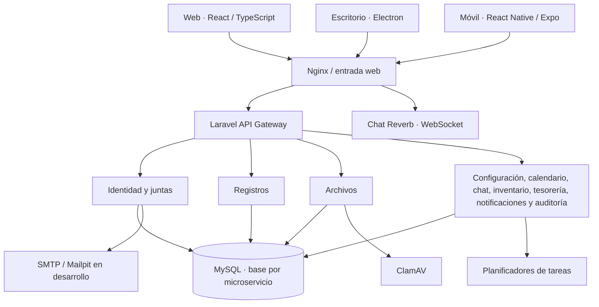

# SRD — Sistema de Registro Digital

**Plataforma multi-tenant para Juntas de Acción Comunal (JAC)** · Aplicaciones web, móvil y de escritorio · Arquitectura de microservicios.

> **Estado del proyecto (30 de octubre de 2026):** SRD fue reorganizado en **cinco repositorios independientes**, con el código, la base de datos, la infraestructura y los entregables separados por responsabilidad. La migración y sus README se integraron a la rama `dev` de cada repositorio. **Esta página es el índice central del proyecto y el punto de partida para nuevos colaboradores.**

> **Nota para evaluación:** este repositorio padre (`SRD-v1`) se conserva como referencia histórica e índice documental. **El código fuente vigente y sus pipelines se mantienen en los cinco repositorios oficiales enlazados a continuación**, principalmente en sus ramas `dev`; no están integrados automáticamente en `main` ni en `qa` del repositorio padre. Evalúa los cinco repositorios y sus evidencias de manera conjunta, sin considerar `SRD-v1` como una copia ejecutable y sincronizada.

[](https://github.com/jsgh1/SRD-v1/tree/dev)
[](https://github.com/jsgh1/SRD-Backend/tree/dev)
[](https://github.com/jsgh1/SRD-Frontend/tree/dev)
[](https://github.com/jsgh1/SRD-Database/tree/dev)
[](https://github.com/jsgh1/SRD-Docker-Infra/tree/dev)

## Navegación

- [Los cinco repositorios oficiales](#los-cinco-repositorios-oficiales)
- [Arquitectura y conexiones](#arquitectura-y-conexiones)
- [Cómo ejecutar el sistema](#cómo-ejecutar-el-sistema)
- [Módulos y características](#módulos-y-características)
- [Pruebas y evidencias](#pruebas-y-evidencias)
- [Rol del repositorio padre](#rol-del-repositorio-padre)
- [Ramas y contribución](#ramas-y-contribución)

## Los cinco repositorios oficiales

**Cada botón/nombre abre un repositorio GitHub distinto, con su propio código, historial, ramas, PR y README detallado.** Esta separación facilita que el equipo desarrolle, revise y pruebe un componente sin tener que modificar todo el proyecto.

| Repositorio | ¿Qué contiene? | Acceso directo |
| :--- | :--- | :--- |
| **01 · SRD-Backend** | Gateway, 10 microservicios de dominio en PHP/Laravel, lógica de negocio, autenticación, permisos y contratos API. | **[Repositorio](https://github.com/jsgh1/SRD-Backend/tree/dev)** · [README](https://github.com/jsgh1/SRD-Backend/blob/dev/README.md) |
| **02 · SRD-Frontend** | Interfaz web React + Vite/TypeScript, cliente Windows Electron y proyectos móviles React Native/Expo. | **[Repositorio](https://github.com/jsgh1/SRD-Frontend/tree/dev)** · [README](https://github.com/jsgh1/SRD-Frontend/blob/dev/README.md) |
| **03 · SRD-Database** | Migraciones Laravel versionadas, estructura SQL y configuración de usuarios/permisos MySQL por microservicio. | **[Repositorio](https://github.com/jsgh1/SRD-Database/tree/dev)** · [README](https://github.com/jsgh1/SRD-Database/blob/dev/README.md) |
| **04 · SRD-Docker-Infra** | Docker Compose, Dockerfiles, Nginx, redes, Mailpit, ClamAV, Reverb, scripts de operación, pruebas y despliegue. | **[Repositorio](https://github.com/jsgh1/SRD-Docker-Infra/tree/dev)** · [README](https://github.com/jsgh1/SRD-Docker-Infra/blob/dev/README.md) |
| **05 · SRD-Docs** | Entregables académicos organizados en **`Entregables/PDF`** y **`Entregables/Word`** (12 documentos por formato). | **[Repositorio](https://github.com/jsgh1/SRD-Docs/tree/dev)** · [README](https://github.com/jsgh1/SRD-Docs/blob/dev/README.md) |

### Mapa rápido

```text
SRD — Plataforma completa
│
├── 01. SRD-Backend
│   ├── contracts/                  # API y eventos
│   ├── packages/php/               # Componentes PHP compartidos
│   └── services/                   # Gateway y diez dominios Laravel
│
├── 02. SRD-Frontend
│   └── apps/
│       ├── web/                    # React + TypeScript + Vite
│       ├── desktop/                # Electron
│       ├── mobile-expo/            # Expo / React Native
│       └── mobile/                 # React Native CLI
│
├── 03. SRD-Database
│   ├── services/*/database/migrations/  # Migraciones Laravel
│   └── database/03_dcl/            # Aprovisionamiento de MySQL
│
├── 04. SRD-Docker-Infra
│   ├── compose.yaml                # Entorno local
│   ├── compose.production.yaml     # Configuración de producción
│   ├── docker/                     # Imágenes, Nginx y antivirus
│   ├── scripts/                    # Inicialización, arranque y QA
│   └── tools/                      # Fixtures, Playwright, verificadores
│
└── 05. SRD-Docs
    ├── README.md
    └── Entregables/
        ├── PDF/                    # 12 PDF
        └── Word/                   # 12 DOCX editables
```

> **Importante:** los cinco repositorios son **independientes**. Los enlaces anteriores no son submódulos Git ni copias internas de este repositorio padre. Para ejecutar la aplicación se requiere **ensamblar temporalmente** el contenido de los repositorios de código en un `workspace` y utilizar la infraestructura de Docker.

## Arquitectura y conexiones



### ¿Cómo se comunican?

1. **Frontend → Gateway:** el navegador usa rutas `/api/v1/` del mismo origen; los clientes móvil/escritorio se conectan al servidor de SRD según su configuración.
2. **Gateway → microservicios:** el Gateway dirige las solicitudes HTTP/JSON al servicio del dominio correspondiente a través de la red privada Docker.
3. **Microservicios → MySQL:** once bases y cuentas de servicio independientes (incluido Gateway); en cada dominio se debe respetar además el contexto de la junta (`organization_id`).
4. **Notificaciones y trabajo diferido:** el correo se envía vía SMTP; los planificadores procesan entregas, recordatorios y reintentos.
5. **Archivos y chat:** Files integra antivirus ClamAV; Chat utiliza Reverb para conexiones WebSocket en tiempo real.
6. **Docker Infra:** ensambla el código, construye las imágenes y configura el proxy, las redes, los volúmenes y los servicios de apoyo.

**La separación del código por repositorios y la separación de bases de datos son complementarias:** el desarrollo se organiza en cinco repositorios Git; el sistema ejecuta once aplicaciones Laravel con límites de datos y comunicación definidos.

## Cómo ejecutar el sistema

### Requisitos

Git, Docker Desktop con Docker Compose, PowerShell y Node.js. Para aplicaciones móviles/escritorio se requieren herramientas adicionales indicadas en el README de Frontend. **No hace falta instalar once Laravel manualmente** si se utiliza el montaje Docker documentado.

### Paso 1 · Clonar los cinco repositorios

En una carpeta nueva dedicada a SRD, desde PowerShell:

```powershell
$Root = Join-Path $HOME 'Desktop\SRD-Split'
New-Item -ItemType Directory -Force $Root | Out-Null
Set-Location $Root

git clone --branch dev https://github.com/jsgh1/SRD-Backend.git
git clone --branch dev https://github.com/jsgh1/SRD-Frontend.git
git clone --branch dev https://github.com/jsgh1/SRD-Database.git
git clone --branch dev https://github.com/jsgh1/SRD-Docker-Infra.git
git clone --branch dev https://github.com/jsgh1/SRD-Docs.git
```

No se recomienda clonar encima de carpetas que ya tengan trabajo local; estos comandos están pensados para un directorio **nuevo**.

### Paso 2 · Ensamblar el entorno Docker

La orquestación está exclusivamente en [**SRD-Docker-Infra — Guía de instalación**](https://github.com/jsgh1/SRD-Docker-Infra/blob/dev/README.md#4-ensamblaje-de-los-cinco-repositorios).

Desde allí se explica cómo crear un `workspace/` de construcción con:

- **Infra:** `compose.yaml`, Dockerfiles, scripts y configuración.
- **Backend:** `services/`, `packages/` y `contracts/`.
- **Frontend:** `apps/`.
- **Database:** superponer sus `services/*/database/migrations/` a los servicios Laravel y añadir `database/`.
- **Docs:** documentos académicos, que no necesitan copiarse dentro de las imágenes.

No debes ejecutar `docker compose up` desde un clon aislado que no contenga todas las dependencias de construcción.

### Paso 3 · Levantar SRD

Después de ensamblar correctamente `workspace/`, usa un nombre de proyecto Compose **propio** en computadores compartidos para no afectar los contenedores de otros usuarios:

```powershell
Set-Location (Join-Path $Root 'workspace')
$env:COMPOSE_PROJECT_NAME = 'srd-mi-entorno'

.\scripts\Initialize.ps1
.\scripts\Up.ps1

docker compose ps
```

| Interfaz | URL de desarrollo |
| :--- | :--- |
| Sistema web SRD | http://127.0.0.1:8080 |
| Bandeja de correos de prueba (Mailpit) | http://127.0.0.1:8025 |

El script de arranque prepara MySQL, inicializa las migraciones, construye los servicios y levanta la web y sus dependencias. **No uses las variables del VPS de producción ni borres volúmenes de proyectos ajenos.**

## Módulos y características

SRD concentra sus funcionalidades por dominios:

| Área | Alcance |
| :--- | :--- |
| **Acceso y juntas** | Autenticación, códigos de verificación, sesiones, roles, membresías, invitaciones y contexto multi-tenant |
| **Registro de personas** | Datos de habitantes/afiliados, campos adicionales, filtros, cargos, planillas y exportaciones |
| **Configuración** | Parámetros de junta, permisos delegables, términos, perfiles y accesos rápidos |
| **Carpetas y archivos** | Carpetas internas, documentos privados, imágenes, previsualización, descarga y análisis antivirus |
| **Inventario** | Activos, entradas y salidas, movimientos e historial |
| **Tesorería** | Ingresos y egresos informativos, consulta de saldos y comprobantes; **no es una plataforma bancaria** |
| **Calendario** | Eventos, participantes, agenda y recordatorios |
| **Chat** | Conversaciones, mensajería y comunicación en tiempo real |
| **Notificaciones y auditoría** | Avisos internos, entregas, trazabilidad y revisión de eventos |

La disponibilidad de cada funcionalidad depende del rol, la junta y la versión desplegada. Los detalles técnicos de implementación se encuentran en los repositorios responsables.

## Pruebas y evidencias

La **migración de código a cinco repositorios** fue verificada en un entorno Docker independiente en octubre de 2026. Resultados obtenidos en esa revisión:

| Comprobación | Resultado |
| :--- | :--- |
| Integración Git | Los cinco repositorios fusionados a `dev` |
| Backend | **305 pruebas PHPUnit** y **6.292 aserciones** exitosas |
| Frontend | Compilación React/Vite y chequeo de TypeScript aprobados |
| Database | Sintaxis de **72 migraciones PHP** comprobada |
| MySQL | **11/11** servicios con acceso a su base, **110/110** intentos de lectura cruzada rechazados |
| Infraestructura | Compilación limpia de Reverb, Compose validado, antivirus ClamAV con prueba EICAR |
| Navegador | **2/2** pruebas E2E de acceso, registros y controles de sesión aprobadas |

**Evidencias verificables:** [PHPUnit](https://github.com/jsgh1/SRD-Backend/actions/runs/39979516811) · [Build web](https://github.com/jsgh1/SRD-Frontend/actions/runs/39979167158) · [Migraciones](https://github.com/jsgh1/SRD-Database/actions/runs/39979177188) · [Compose / Reverb](https://github.com/jsgh1/SRD-Docker-Infra/actions/runs/39980062621).

Estas cifras documentan la **validación realizada**, no reemplazan una aceptación funcional completa, una prueba de aislamiento entre dos juntas ni una autorización automática para desplegar en producción. Para nuevas versiones se deben repetir las pruebas sobre el conjunto de commits que se vaya a liberar.

## Rol del repositorio padre

**[SRD-v1](https://github.com/jsgh1/SRD-v1/tree/dev)** es la **referencia histórica e índice general** de SRD. Todavía conserva en su árbol carpetas como `apps/`, `services/`, `database/`, `scripts/`, `docker/` y `docs/`, correspondientes a la estructura integrada anterior.

Esto es intencional y se documenta para evitar confusiones:

- **Para consultar los componentes separados y continuar el desarrollo:** utiliza los **cinco repositorios oficiales** enlazados arriba.
- **Para construir el sistema desde los repositorios nuevos:** sigue **SRD-Docker-Infra** y ensambla Backend, Frontend y Database en un `workspace` temporal.
- **Para consultar entregables académicos actualizados:** entra a **SRD-Docs → [Entregables](https://github.com/jsgh1/SRD-Docs/tree/dev/Entregables)**.
- **Para consultar el snapshot integrado anterior:** permanece este repositorio padre; los cambios en los cinco repositorios **no se sincronizan automáticamente** a sus carpetas antiguas.

> El README crea un **catálogo de enlaces**; **no incorpora submódulos, subtrees, copias de los otros repositorios ni automatiza sincronización**. Una integración de código real requiere seguir el ensamblaje reproducible indicado por Infra.

## Ramas y contribución

```text
rama hija (fix/*, feat/*, docs/*)
              │
              ▼
     Pull Request + revisión + CI
              │
              ▼
             dev          ← integración de desarrollo
              │
              ▼
              qa          ← pruebas de aceptación
              │
              ▼
             main         ← liberación aprobada
```

**Buenas prácticas:** mantener PR separados por repositorio; coordinar cambios que afectan contratos entre frontend, backend y base de datos; fijar los SHAs de cada componente para ensamblajes reproducibles; no versionar `.env`, claves, copias con datos personales ni artefactos generados. La existencia de `main` no implica por sí sola que un cambio esté desplegado: **el VPS se administra y despliega de forma independiente**.

---

### Enlaces de referencia

**[Backend](https://github.com/jsgh1/SRD-Backend/tree/dev)** · **[Frontend](https://github.com/jsgh1/SRD-Frontend/tree/dev)** · **[Database](https://github.com/jsgh1/SRD-Database/tree/dev)** · **[Docker Infra](https://github.com/jsgh1/SRD-Docker-Infra/tree/dev)** · **[Docs y Entregables](https://github.com/jsgh1/SRD-Docs/tree/dev)**

**Mantenedor:** [jsgh1](https://github.com/jsgh1) · **Proyecto:** Sistema de Registro Digital (SRD).
